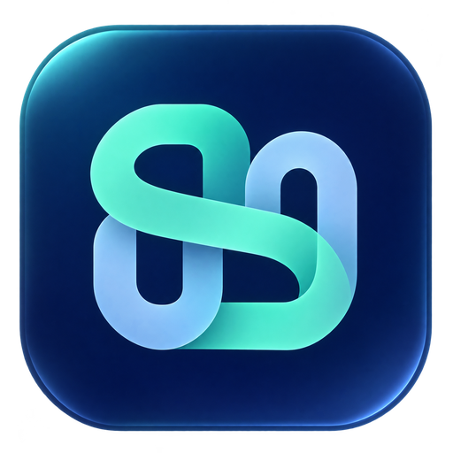

# SaveHUB



Satu aplikasi desktop untuk WhatsApp, Telegram, Instagram, Facebook, Discord, TikTok, Threads, X, dan Reddit. Dikembangkan oleh **savemeours** dengan tampilan glassmorphism dan sesi akun yang terpisah.

## Unduh

Buka [GitHub Releases](https://github.com/savemeours/SaveHUB/releases) dan pilih paket sesuai perangkat. Berkas installer akan tersedia setelah job build pada [Actions](https://github.com/savemeours/SaveHUB/actions) selesai.

| Sistem | Arsitektur | Paket |
| --- | --- | --- |
| Windows | x64 | Installer NSIS dan portable `.exe` |
| macOS | Apple Silicon arm64 / Intel x64 | `.dmg` dan `.zip` |
| Linux | x64 / arm64 | `.AppImage` dan `.deb` |

Rilis awal diberi label **pre-release**. Paket Windows/macOS belum menggunakan sertifikat penerbit/Developer ID dan notarization yang disediakan pengguna. Ini bukan aplikasi resmi dari penyedia platform. Dukungan panggilan, OAuth, notifikasi, serta izin sistem bergantung situs dan OS.

## Fitur

- Sembilan platform dalam satu jendela.
- Multiakun dengan partisi login terpisah.
- Blur chat, nama, avatar, dan media per platform.
- Kunci PIN, penguncian otomatis, dan mode fokus.
- Pengelola unduhan dan penghemat RAM.
- Splash screen, tema terang/gelap, favorit, dan pintasan keyboard.
- Identitas SaveHUB untuk taskbar, Dock, dan launcher desktop.

Relay notifikasi dengan identitas platform tersedia pada Windows. Notifikasi macOS/Linux mengikuti sistem bawaan; penyamaran isi notifikasi pada kedua OS tersebut belum diimplementasikan. Pembaruan otomatis belum aktif karena sumber rilis bertanda tangan belum dikonfigurasi. Kunci PIN melindungi akses tampilan, bukan enkripsi disk.

## Menjalankan source

Gunakan Node.js 24 LTS:

```bash
npm ci
npm start
```

Mode source memakai runtime pengembangan. Untuk distribusi dan ikon aplikasi yang benar, gunakan installer atau paket hasil build.

## Build

| Target | Perintah / skrip |
| --- | --- |
| Windows x64 | `BUILD-WINDOWS.bat` atau `npm run dist:win` |
| macOS sesuai prosesor host | `bash BUILD-MACOS.command` |
| macOS Apple Silicon | `npm run dist:mac:arm64` |
| macOS Intel | `npm run dist:mac:x64` |
| Linux sesuai prosesor host | `bash BUILD-LINUX.sh` |
| Linux x64 | `npm run dist:linux:x64` |
| Linux arm64 | `npm run dist:linux:arm64` |

DMG dibuat pada macOS. Paket hasil build tersedia di `release/`; direktori tersebut serta `node_modules/` tidak dimasukkan ke Git.

## Build dan rilis otomatis

- **Test desktop source** memeriksa commit dan pull request pada Linux, Windows, dan macOS.
- **Build SaveHUB Windows/macOS/Linux** dapat dijalankan manual untuk membuat artifact masing-masing OS.
- **Build and publish desktop packages** berjalan ketika rilis GitHub dipublikasikan. Lima job memeriksa versi tag, menjalankan tes, membangun paket, lalu mengunggahnya ke rilis yang sama.
- Gunakan tag yang cocok dengan `package.json`, misalnya `v4.4.0`. Build ulang rilis yang sama dapat dilakukan melalui `workflow_dispatch` dengan tag tersebut.
- Workflow rilis menggunakan token sementara GitHub Actions; tidak ada token pribadi atau kredensial Apple/sertifikat Windows di repository.

## Panduan

- [macOS](MACOS.md)
- [Linux](LINUX.md)
- [Ikon taskbar Windows](TASKBAR-WINDOWS.md)
- [Notifikasi Windows](NOTIFIKASI-WINDOWS.md)
- [Fitur desktop](FITUR-3.0.md)
- [Validasi dan batas pengujian](VALIDASI.md)
- [Riwayat perubahan](CHANGELOG.md)

## Lisensi

[MIT](LICENSE). Ikon platform memakai Font Awesome Free; lihat [atribusi pihak ketiga](THIRD-PARTY-NOTICES.txt). Logo/merek platform tetap milik pemiliknya masing-masing. SaveHUB menggunakan Electron dengan sandbox dan isolasi konteks; dependensi mempertahankan lisensinya.
